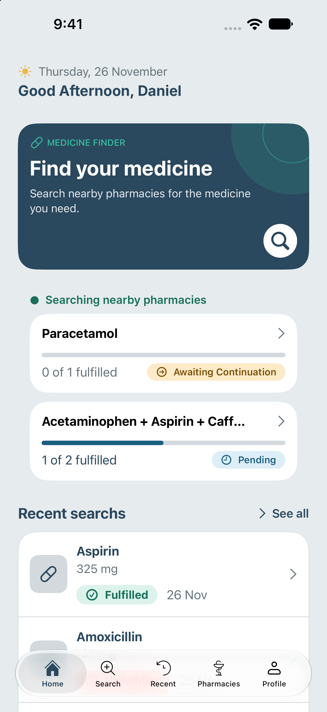
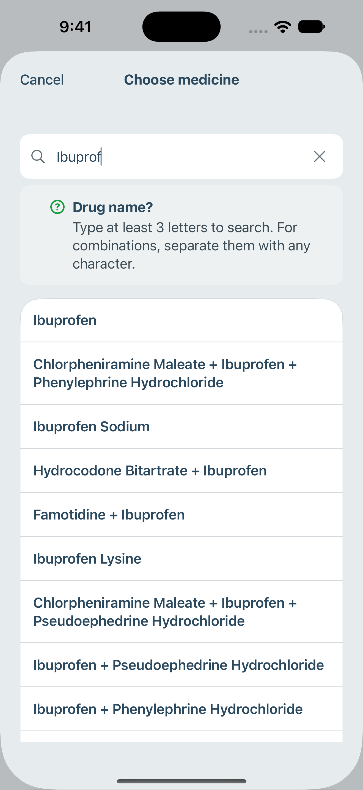
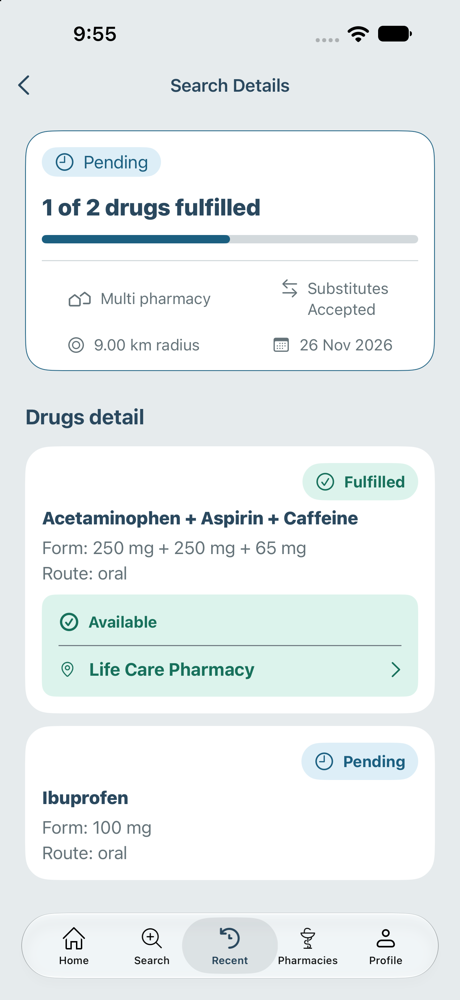
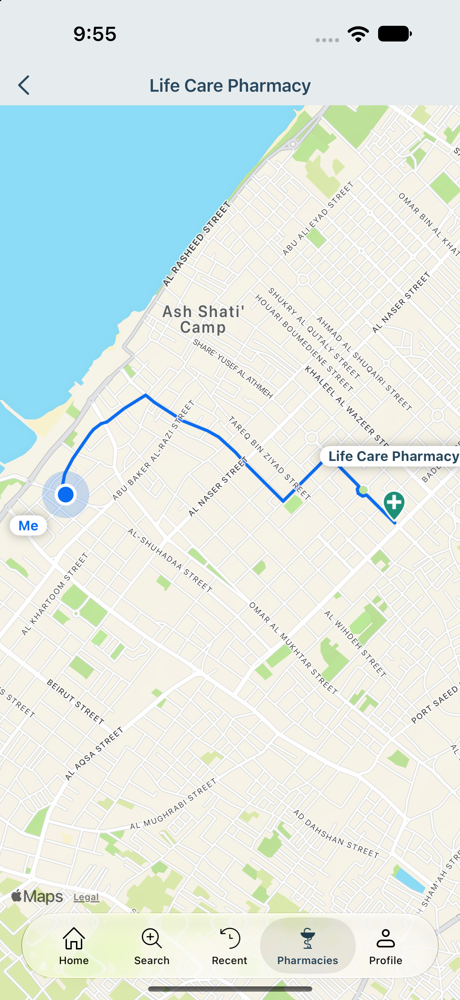
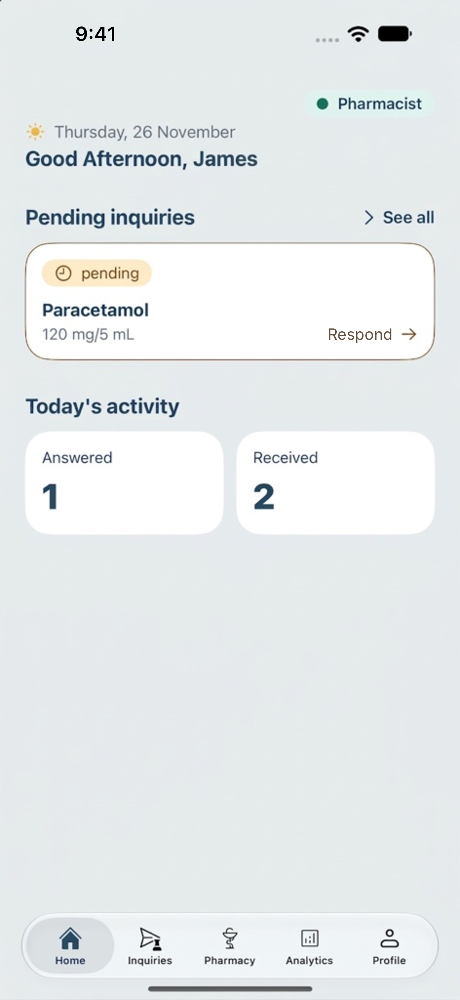
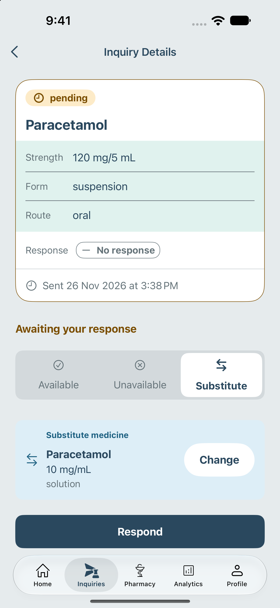
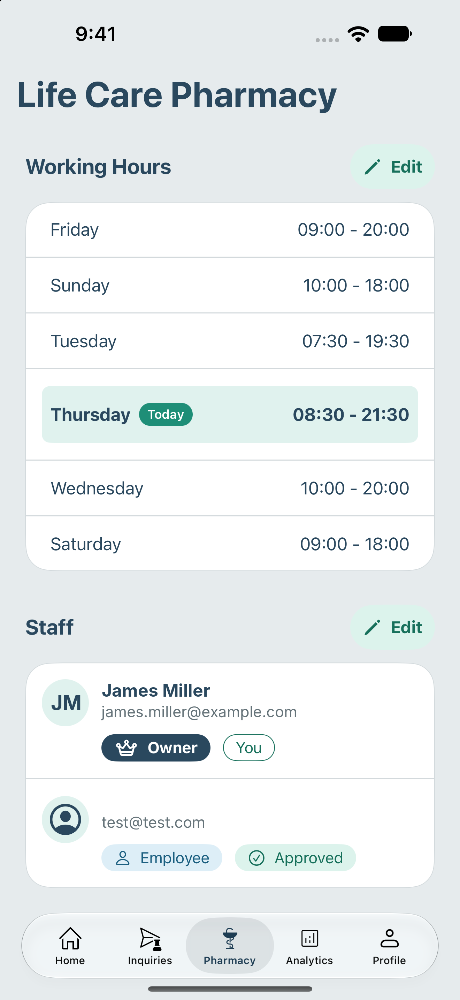
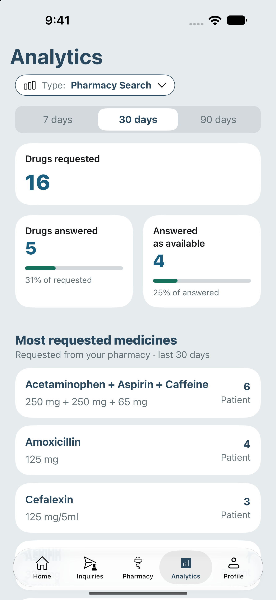

# PharmaScout

> Scout nearby pharmacies for the medicine you need.

PharmaScout is an iOS app that helps people find medicines by checking nearby pharmacies in real time. A patient searches for a medicine, and PharmaScout inquires with nearby registered pharmacies on their behalf, surfacing every pharmacy's response in one place.

## Screenshots

### Patient

  
  
  
  

### Pharmacist

  
  
  
  

## About this project

I built PharmaScout entirely on my own, without vibe coding. I designed and wrote both the backend logic (database, Postgres functions, Edge Functions) and the iOS client myself.

## Features

### For patients
- Sign in with email, Apple or Google, and link them to one account.
- Search for one or more medicines, each with a generic name and formulation (strength, form and route), with autocomplete.
- Choose whether everything must come from a **single pharmacy** or can be sourced across **multiple pharmacies**.
- Choose whether to **accept substitutes** if the exact medicine isn't available.
- Browse nearby pharmacies with their working hours and contact details.
- See the history of your search requests.
- Get a push notification when a medicine is found.

### For pharmacies
- Get a push notification and a live update when a new inquiry arrives.
- Respond to inquiries: confirm availability, say it's unavailable, or suggest a substitute.
- Update a medicine's availability later if it comes back in stock.
- View demand analytics: most-searched medicines in the region.
- Manage working days and hours.
- Add and manage employees: issue join codes, approve or reject requests, and suspend or remove employees.
- Close a pharmacy. Its staff can then join another one.

## How a search works

1. **Initiation.** The patient adds medicines, each with a generic name and formulation, then picks a fulfillment mode and a substitute preference.
2. **Inquiring.** Nearby pharmacies are selected from the patient's last known location. Only registered pharmacies, meaning those approved by an admin, are searched and shown to patients. A pharmacy is skipped if it was already contacted about that medicine within the cooldown window.
3. **Response.** Each pharmacy answers *Available*, *Unavailable* or *Substitute*. A substitute is shown to the patient only if they chose to accept substitutes.
4. **Continuing.** The next pharmacy is inquired when the response timeout elapses with no reply, or when the pharmacy answers unavailable or offers a substitute the patient doesn't want.
5. **Stopping.** The search stops and the patient is notified when all required medicines are found. If every pharmacy within the determined radius has been asked without a full match, the patient is notified and asked whether to expand the search.

**Example:** a patient searches for Ibuprofen 200 mg, Amoxicillin 500 mg and Panadol 500 mg.

| Pharmacy | Ibuprofen | Amoxicillin | Panadol |
|---|---|---|---|
| 1 | ✅ | ❌ | ❌ |
| 2 | ❌ | ✅ | ✅ |
| 3 | ✅ | ✅ | ✅ |

- *Single-pharmacy mode:* pharmacy 3.
- *Multi-pharmacy mode:* pharmacies 1 + 2.

## Roles

| Role | How they get access |
|---|---|
| **Patient** | Signs up freely. |
| **Pharmacy owner** | An admin issues a code; the user redeems it to send a pending request; once an admin accepts, they can create a pharmacy, which is itself reviewed by an admin. One pharmacy per owner at a time; an owner can close their pharmacy. |
| **Pharmacy employee** | Joins with an owner-issued code, then the owner approves the request. The owner can later suspend or remove them. |
| **Admin** | Approves owners and pharmacies. |

Roles are derived from table membership; there is no role column on the user.

## Privacy

Your data is yours. You can delete your account at any time from within the app, with a recent re-authentication required as a safeguard.

## Tech stack

- **iOS:** Swift, SwiftUI, Xcode
- **Backend:** [Supabase](https://supabase.com), accessed directly from the app through the Supabase Swift SDK
- **Push notifications:** Apple Push Notification service (APNs)
- **Medicine data:** sourced from [openFDA](https://open.fda.gov)

### How Supabase is used

| Supabase feature | What it does in PharmaScout |
|---|---|
| **Auth** | Email, Apple and Google sign-in, with identities linkable to one account. |
| **Postgres + Data API** | The app talks to the database directly through the Swift SDK, with no custom server in between. |
| **Row Level Security** | Enabled and secure by default, so access is limited by role (patient, pharmacy staff, admin). |
| **Postgres functions (RPC)** | Business logic in the database, such as creating and joining with pharmacy codes, loading the account state that gates the pharmacist tabs, and checking whether an account can be deleted. |
| **Cron** | A scheduled job runs the search engine: it picks the next pharmacy to ask, handles response timeouts and updates the search status. |
| **Database triggers** | Fire push notifications: staff get one on a new inquiry, and the patient gets one when a medicine is found. |
| **Realtime** | Patients see pharmacy responses as they arrive, and pharmacists see new inquiries as they come in, with no refreshing. |
| **Edge Functions** | `send-push` delivers notifications through APNs. `delete-account` handles account deletion: it checks the user is allowed to delete, revokes Sign in with Apple, then removes the account. |

## Architecture

- **Backend:** Supabase accessed directly from the client, with RLS on and secure by default.
- **Service layer:** each service is a protocol, an implementation and a mock (`XService` / `DefaultXService` / `MockXService`).
- **Folder layout:** by role and feature, `Features/<Role>/<Feature>/{Views, ViewModels, Models}`.
